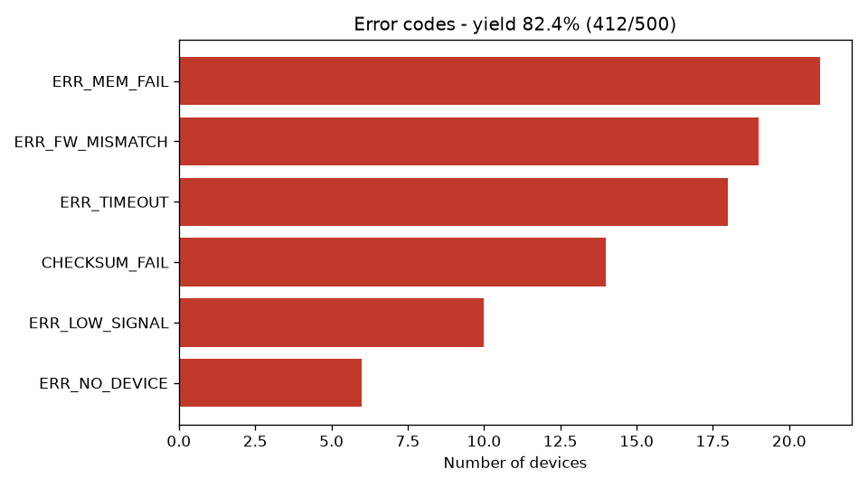

# Log Analyzer Tool

Công cụ Python đọc hàng loạt file `.log` kết quả kiểm tra thiết bị, lọc mã lỗi bằng Regex,
thống kê bằng Pandas và xuất báo cáo Excel kèm biểu đồ. Dữ liệu log là dữ liệu giả lập.

## Cách chạy

```
pip install -r requirements.txt
python generate_logs.py --count 500 --out logs
python log_analyzer.py --logs logs --out report
pytest
```

Kết quả nằm trong thư mục `report/`:

- `report.xlsx`: sheet `Summary` (tổng số, PASS, FAIL, yield rate, defect rate),
  `Devices` (từng thiết bị), `Errors` (số lần gặp của từng mã lỗi theo bước test)
- `errors.png`: biểu đồ mã lỗi



## Định dạng log

```
2026-11-10 08:00:27 [INFO] SN=DUT000001 STATION=FT1 START
2026-11-10 08:00:29 [INFO] STEP=FW_VERSION RESULT=PASS
2026-11-10 08:00:31 [ERROR] STEP=WIFI_TEST RESULT=FAIL CODE=ERR_TIMEOUT
2026-11-10 08:00:32 [INFO] SN=DUT000001 FINAL=FAIL
```

Log thiếu dòng `FINAL` (test bị ngắt giữa chừng) được đánh dấu `INCOMPLETE`.

## Cấu trúc

- `generate_logs.py`: sinh log giả lập
- `log_analyzer.py`: `parse_log` (Regex) -> `parse_folder` (DataFrame) -> `summarize`, `error_table` -> `export_report`
- `tests/`: unit test bằng pytest
